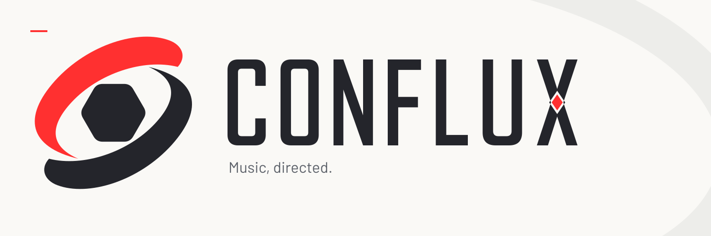

<picture>
  <source media="(prefers-color-scheme: dark)" srcset="brand/assets/social/social-banner-dark.png">
  <source media="(prefers-color-scheme: light)" srcset="brand/assets/social/social-banner-light.png">
  
</picture>

# CONFLUX

[](CODE_OF_CONDUCT.md) &nbsp; [](https://www.conventionalcommits.org/en/v1.0.0/) &nbsp; [](LICENSE) &nbsp; [](https://github.com/zricethezav/gitleaks)<br>
[](https://semver.org) &nbsp; [](https://discord.gg/DSvUNYm)

A native Linux DJ application built with C++20, Qt Quick and PipeWire, with
CONFLUX branding and a CDJ-3000-style performance view.

The project is building toward an AI DIRECTOR that arranges and mixes music
while the performer controls EQ and effects. The current player provides
manual two-deck playback; automatic preparation, stems, editable sets and AI
direction are the next stages of development.

## Current player

- Two local-file decks with mono/stereo decoding at 8–192 kHz, prepared as
  stereo 48 kHz float audio.
- Play/pause, temporary CUE, overview seeking and positional jog, with short
  ramps for transport and gain changes.
- Background preparation and bounded read-ahead. Replacing one track keeps
  the other deck and recording running.
- Independent master and headphone mixes, explicit PipeWire routing, channel
  and bus levels, stereo peak/RMS meters and overrange indicators.
- Manual IN/OUT/RELOOP for prepared tracks and stem banks.
- Fixed A/B crossfader with independent headphone cue and short gain ramps.
- Live post-master stereo WAV recording, plus a shared headless render core.
- Light and dark performance views using the supplied CONFLUX artwork.

Hot cues, tempo/sync, EQ and effects remain
inactive until their audio features are implemented. Jog searches the track
position; scratch and pitch bend are planned.

## Development status

**M1, the manual audio foundation, is complete within its tested scope.**
Automated audio/control tests, private routing checks and a full 30-minute
laptop audio/UI/recording soak passed. The user accepted current playback,
transitions and recorded WAV replay on home speakers on 18 October 2026.
Separate physical headphone isolation and device-clock behavior remain
unverified where the required interfaces are unavailable. See the
[M1 results and listening record](docs/M1.md).

**M2 is in progress: library preparation and stems.** Its first slices add
[persistent preparation, cancellation and local library import/load](docs/M2.md). The live-stem
service target remains a release blocker: the latest completed validation measured
**5.1722 seconds p99 against a 4.095-second target**. The approved
[M0 feasibility decision](docs/decisions/0002-m0-stem-runtime.md) retains that
target unchanged. Manual playback qualification does not measure stem inference.

The [development plan](docs/handoff/PLAN.md#implementation-sequence-and-exit-criteria)
covers M0–M6, ending with the first usable release. This is a development
prototype; release installation packages are not available yet.

## Build and run

Use Linux with a running PipeWire session. The native window targets Wayland.
Build requirements are a C++20 compiler, CMake 3.25+, Ninja, pkg-config,
PipeWire 0.3.65+, libsndfile 1.2+, libsamplerate 0.2.2+, TagLib 1.13+ and
Qt 6.4+ with Quick, Quick Controls 2, SVG and Concurrent. Tests also use Qt Test and
Python 3.11+ with NumPy. Contributors also need Node.js and pnpm 11.28.5 for
the repository's commit tools.

On Arch Linux, install the development dependencies:

```sh
sudo pacman -S --needed base-devel cmake ninja pkgconf pipewire libsndfile \
  libsamplerate taglib qt6-base qt6-declarative qt6-svg python python-numpy pnpm
```

Current Arch packages include the Wayland client plugin in `qt6-base`; see the
[Arch dependency update](https://archlinux.org/todo/qt6-wayland-dependency-cleanup/).
Ubuntu 24.04 is covered by the [CI dependency list](.github/workflows/build.yml).
From the development checkout:

```sh
pnpm install --frozen-lockfile
git config core.hooksPath .github/hooks
cmake -S . -B build/dev -G Ninja -DCMAKE_BUILD_TYPE=RelWithDebInfo \
  -DPython3_EXECUTABLE=/usr/bin/python3
cmake --build build/dev --parallel 2
ctest --test-dir build/dev --output-on-failure
build/dev/conflux
```

Open **LIBRARY** or a deck's **BROWSE** control, enter an absolute local-file
path and choose **LOAD A** or **LOAD B**. Each new track starts paused at zero.
The current preparation limit is 256 MiB per track, about 11 minutes 39 seconds
of stereo 48 kHz float audio. Playback uses a 48 kHz graph.
Prepared audio is cached between loads. **CANCEL PREPARATION** leaves current
playback intact; cancellation ends when installation starts.
Choose **IMPORT** to keep a track in the library, then select its saved row
and use **LOAD A** or **LOAD B**. Import cancellation ends when saving starts.
Changed files must be imported again; musical analysis remains pending.

Use **AUDIO / REC** to select outputs or record the master mix to a new absolute
`.wav` path. Default master playback works with a stereo output; separate
headphone cue needs four distinct destinations across master and cue. Stop
recording before applying output changes.

## Project references

- [Control inventory and implementation status](docs/cdj-controls.md)
- [Architecture decisions](docs/decisions/)
- [Milestones and product requirements](docs/handoff/PLAN.md)
- [Brand asset register](brand/ASSET-REGISTER.md) and [brand guide](brand/CONFLUX-brand-guide.pdf)
- [Contributing](CONTRIBUTING.md) and [code of conduct](CODE_OF_CONDUCT.md)

Local builds, model weights, music, recordings and generated caches stay out
of source history. Numerical and benchmark reports are retained under
[`docs/benchmarks/`](docs/benchmarks/).

## License

Software is licensed under the [GNU AGPLv3](LICENSE). Bundled font licenses
are retained with the [brand fonts](brand/assets/fonts/); those notices apply
to the fonts separately from the application source.

A [KYAU Labs](https://kyaulabs.com/) project.
