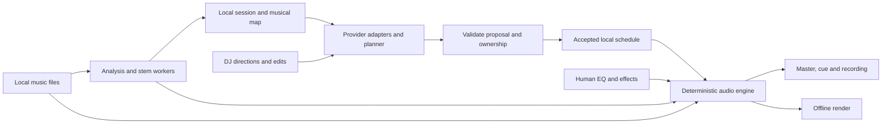

# CONFLUX development handoff

Prepared 15 October 2026; updated 16 October 2026 for the existing CONFLUX Codex
project.

Build a native Linux DJ application that looks and operates like a Pioneer
CDJ-3000 setup, with CONFLUX branding. The AI arranges and mixes music while
the performer controls EQ and effects. Support complete manual operation,
editable sets and offline mix rendering as well as live performance.

This document records the user's decisions and recommends an implementation
order. The application has not been built or benchmarked. Engineering defaults
and performance targets below are recommendations, not measured results.

## Start here

| Item | Location or requirement |
| --- | --- |
| Repository | https://github.com/kyaulabs/conflux |
| Local checkout / Codex project default folder | `/home/kyau/projects/kyaulabs/conflux` |
| Codex project | Already created by the user. Open a new chat in that existing project and use `START-HERE.md`. |
| Project instructions | Read the checkout's `AGENTS.md` and applicable parent instructions before work. |
| Required writing skill | `/home/kyau/.pi/agent/npm/node_modules/@kyaulabs/prism-core/skills/distill/SKILL.md` |
| Existing identity | `brand/` in the checkout, approved version 1.1 |
| Hardware reference | [User-supplied CDJ-3000 / DJM-900NXS2 setup](references/pioneer-cdj3000-djm900nxs2-setup.png) |
| Software license | Preserve the existing GNU AGPLv3 `LICENSE`. |

The inspected checkout was on `develop`, tracking `origin/develop`, with
user-added, untracked `AGENTS.md` and `brand/`. Preserve these files. The public
repository's default branch was `main`; do not confuse that with the active
checkout. Recheck status and instructions because the user may have continued
editing after this handoff.

The repository currently contains KYAU Labs template documentation and Git
configuration. Read the relevant files before changing them. `AGENTS.md`
requires signed conventional commits with detailed bodies, work on branches
named `<type>/kyau-<six-hex-digits>-<description>`, commits/reviews as `kyau`,
and PRs as `kyaulabs-bot` using `.github/PULL_REQUEST_TEMPLATE.md`. Complete its
Test Plan before approval, retain hooks, and investigate failing workflows.
Follow the applicable instructions where the older `CONTRIBUTING.md` branch
example differs. Preserve README layout, logos, primary headers and badges.
When adapting template metadata, update actual `kyaulabs/template` links in
`cliff.toml` within the relevant setup change.

Use the distill skill for major documentation. Its detailed writing reference
is `references/patterns.md` beside that skill. Preserve exact commands, paths,
technical terms and user requirements while making one editing pass for clarity.

## Confirmed product requirements

| Area | Required behavior |
| --- | --- |
| Platform | Native Linux, Qt/KDE, Wayland as the primary window-system target. The laptop is the primary machine. |
| Performance interface | Familiar CDJ-3000 deck layout and behavior, with the pictured DJM-900NXS2-style central mixer. Use CONFLUX artwork. |
| Decks and input | Two decks by default, up to four. Mouse and keyboard take priority; touchscreen is also in initial scope. Physical controllers come later. |
| Music library | Local files for the first usable release. Automatically prepare timing, musical analysis and cue points; also import cues. |
| Genres | EDM, Dubstep, HipHop, Rockstep, Pop and Rock. Include variable-tempo material in testing. |
| Set order | Both a user-specified order and AI-selected/reordered sets. Offer harmonic and other musically useful ordering strategies. |
| Arrangement style | Follow user direction: play most/all of songs or shorten, loop and rearrange sections. The AI must have broad arrangement freedom. |
| Instructions | Accept typed and spoken directions during a set. Ask for clarification when a direction is ambiguous while the existing plan keeps playing. |
| Performer control | AI handles arrangement, cueing, transport, timing, transitions and stem mixing. Human EQ and effects remain under human control. |
| Manual takeover | A deck taken over by the DJ stays under human control until explicit hand-back. The AI continues managing other decks. |
| AI providers | User-configured OpenAI- and Anthropic-compatible endpoints, including a user-provided local server such as llama.cpp. No bundled offline language model is required. |
| Provider outage | Keep playback uninterrupted, execute the last valid plan, then use conventional mixing rules. Notify the DJ. |
| Song data | Analyze locally by default and send compact musical facts/timing to the planner. Offer optional cloud audio analysis for permitted material and capable providers. |
| Stems | Prepared stems and on-demand separation during playback are both required in the first usable release. Evaluate Vulkan acceleration first. |
| Stem fallback | Prefer prepared stems. Use a separately validated full-track transition when it fits the direction. For an explicitly stem-only transition, keep suitable current/prepared material playing until the required stems are ready; do not restore unwanted parts. |
| Audio routing | Master and headphone cue on separate channels of one multichannel interface, or routed to separate audio devices. |
| Effects | Built-in effects first. Third-party plugin hosting comes later. |
| Sessions | Save the whole editable set, including accepted AI plans, cues/timing, arrangement, stems, transitions and human EQ/effect automation. |
| Editing | A visual timeline alongside the performance view: move sections, adjust transitions/overlaps, arrange stems and edit recorded automation. |
| Recording and rendering | Stereo live recording and offline rendering of complete mixes. Reproduce saved human automation. Rendering need not run at playback speed. |
| Spatial audio | Genuine Dolby Atmos authoring/export is a later milestone. Investigate the laptop's advertised Atmos playback capability separately. |
| License | AGPL, with the existing AGPLv3 license retained. Distributed modifications must supply the required source. |

The original musical-direction example must remain possible:

> "When you hear X vocals start the transition and merge in right before the drop on the next song".

The application must identify the intended events and ask when "X vocals", the
target drop, or "right before" has several plausible meanings. A menu of fixed
crossfade templates alone does not satisfy this requirement. Complete rekordbox
library migration, streaming services and separate multitrack audio exports have
not been requested for the first usable release.

## Recommended stack and reuse policy

Use **C++20 for the audio engine and application core, Qt 6 with Qt Quick/QML
for the interface, CMake and Ninja for builds, and PipeWire for Linux audio**.
QML is suitable for the custom deck controls and timeline; keep audio processing
outside QML and the UI thread. Use native Qt dialogs and KDE integration where
they help. Introduce KDE Frameworks individually when needed rather than making
the entire framework collection a dependency.

Use Qt's native Wayland platform plugin. Qt Quick's rendering backend and the
stem inference backend are separate choices: benchmark the normal Qt renderer
and Vulkan under inference load. Wayland does not require forcing the UI onto
Vulkan. [Qt Wayland documentation](https://doc.qt.io/qt-6/wayland-and-qt.html),
[Qt Quick rendering backends](https://doc.qt.io/qt-6/qtquick-visualcanvas-adaptations.html).

Evaluate proven open-source decoding, resampling, time-stretching and analysis
components before implementing DSP from scratch. Rubber Band is a candidate
for independent tempo/pitch control and vocal formant preservation. Select a
decoder after checking the formats in the test corpus; FFmpeg or libsndfile
may cover different needs. Document why each selected dependency is needed,
its enabled build options and its license.

Run a bounded Mixxx reuse experiment before committing to a large custom engine
or a fork. Its internal build targets are not proof of a standalone engine SDK.
Reuse is worthwhile only if the needed processing can be isolated behind a
small headless API supporting stem buses, shared live/offline rendering and
CONFLUX ownership rules. Otherwise reuse suitable individual components and
build a focused engine. Preserve the CDJ interface requirement either way.
[Mixxx build definition](https://raw.githubusercontent.com/mixxxdj/mixxx/main/CMakeLists.txt).

Mixxx and Rubber Band declare GPL-2.0-or-later licensing. Their GPLv3 option
can be combined with AGPLv3 under the applicable terms. Retain upstream notices;
do not relabel all upstream files as CONFLUX-owned code. Check model weights,
optional modules and bundled fonts separately. [Mixxx license](https://raw.githubusercontent.com/mixxxdj/mixxx/main/LICENSE),
[Rubber Band license](https://breakfastquay.com/rubberband/license.html),
[GNU combination guidance](https://www.gnu.org/licenses/gpl-faq.en.html#v3Notwithstanding).

Prefer one application with clear module boundaries and worker execution for
slow tasks. Add a separate inference process if needed to contain runtime
failure or GPU stalls. Do not create a distributed service architecture.



Keep five practical boundaries: audio/DSP, media preparation, session/arrangement,
AI/control, and Qt presentation. Start with the few classes and targets needed
for the current milestone. The processing graph, session representation and
commands should be usable without a visible window.

## AI planning and provider integration

Keep authoritative state locally: source and section IDs, musical analysis,
deck state, user instructions, control ownership, arrangement revisions and
the accepted execution schedule. Models receive an appropriate snapshot and
propose changes. They do not own the audio clock.

Use one internal proposal contract for section selection/order, cue references,
loops, source timing, tempo/pitch changes, layering, stem assignments and
transition envelopes. A general planning model can compose these operations
into varied arrangements. A local search can also generate candidates. Use
structured output or tool schemas where supported; validate the result locally.
Do not expose unrestricted executable code or arbitrary parameter writes as
the planner's control surface.

Implement provider adapters in this order: OpenAI-compatible Chat Completions,
Anthropic-compatible Messages, then provider-specific additions when useful.
An OpenAI-compatible endpoint need not implement Responses, Decisions, audio or
schema-constrained output. Store tested capabilities and handle unsupported
features explicitly. Support configurable base URL, model and credentials.
Keep credentials in an appropriate system secret store, outside projects/logs.

The **OpenAI Decisions API is real and currently in public beta**. The checked
guide lists `POST /v1/decisions`, `gpt-6-luna`, and predicate, choice and score
answers. It is a useful optional judge for feasible candidates or narrow
questions. Its advertised speed is not a playback deadline guarantee.
[Official Decisions guide](https://developers.openai.com/api/docs/guides/decisions).

The current standalone API accepts text/image evidence and certain historical
message/tool records, but no audio input. It has no standalone streaming or
conversation continuation parameters in the checked schema. Historical tool
records do not mean it executes tools. Keep the base adapter on text evidence
because SDK and generic reference descriptions differ. Independently selected
answers must still pass joint arrangement validation.
[Current API reference](https://developers.openai.com/api/reference/resources/decisions/methods/create).

**Jev is TypeSafe's decision model**, using supplied state and typed questions.
It can be another optional scorer/selector. Its documented input is text or
structured textual state; audio/video must be analyzed first. Neither service
alone supplies a DJ playback engine or reliable musical event detection.
[Jev introduction](https://docs.typesafe.ai/introduction),
[Jev model documentation](https://docs.typesafe.ai/models).

OpenAI also documents a separate GPT-Live voice-to-Decisions integration with
transcript triggers and decision events. Treat it as an optional voice adapter,
not the base architecture or evidence that Decisions hears music.
[Voice delegation guide](https://developers.openai.com/api/docs/guides/decisions-voice).

For initial voice interaction, recommend push-to-talk to reduce accidental
commands in a loud environment. Route its transcript through the same command,
clarification and validation path as typed input. Select a transcription method
separately from the planning model. A user-provided local planning server does
not automatically provide speech recognition or musical audio analysis.

Before committing a proposal, validate source/section references, available
decks, source ranges, beat/phrase anchors, processing readiness, headroom,
ownership, current revision and execution deadlines. Commit valid changes
automatically within the DJ's direction. Ask about ambiguity rather than asking
permission for every ordinary transition. Reject stale, incomplete, malformed,
refused or late proposals and retain the accepted plan.

Plan ahead of playback, keeping the next transition and a usable conventional
continuation ready where the library permits. Replan after relevant changes,
not once per audio buffer. A provider timeout, rate limit or failure must not
block the engine. The UI should distinguish "AI unavailable", "clarification
needed", "preparing stems" and "following saved plan".

## Musical analysis and mixing policy

Build a local musical map containing source-relative beat/downbeat positions,
bar/phrase estimates, tempo changes, section boundaries, vocal activity,
candidate drops/breakdowns, local key/harmony estimates, loudness and confidence.
Use explicit unknown/low-confidence states. Whole-track BPM and key tags are
insufficient for variable-tempo rock, changing harmony or a specific vocal cue.

Prototype vocal transcription/alignment and musical section detection against
annotated fixtures. Timestamped lyrics are not sufficient on their own to
identify a drop. Broad acoustic event detection and exact phrase recognition
remain empirical risks. If evidence does not identify the requested event,
ask the DJ to choose or place a cue and retain that correction.

Harmonic mixing should rank candidates using the same key, neighboring
circle-of-fifths keys and relative major/minor as starting relationships.
Evaluate the actual overlapping bass, chords and vocals. Camelot positions are
not semitone counts, and compatible tags do not guarantee compatible passages.
[Mixed In Key's official guide](https://mixedinkey.com/workflows/how-to-use-the-camelot-wheel/).

Recognize half/double-time interpretations before applying time stretching.
Key lock should normally preserve pitch when tempo changes. Align downbeats
and phrases as well as BPM; preserve meaningful tempo variation when appropriate.
[Mixxx synchronization and harmonic mixing documentation](https://manual.mixxx.org/2.5/en/chapters/djing_with_mixxx.html).

Recommended initial preferences for ordinary blends are roughly +/-6% tempo
change, no pitch change or +/-1 semitone preferred, and up to +/-2 semitones
when the result works. These are configurable engineering/product defaults,
not user-imposed hard limits or universal music-theory rules. Intentional
larger changes may use cuts, breakdowns, loops, percussion bridges or tempo
ramps. Do not constrain a whole set to a six-percent tempo range.

Preserve vocal character where possible, avoid abrupt key shifts through an
exposed sung phrase, and keep tonal stems coherently tuned. Tuned kicks and
808 bass are not inherently key-neutral. Compare processing strategies on
percussive, harmonic and vocal material; the acceptable transformation depends
on source and algorithm. [Rubber Band integration guidance](https://www.breakfastquay.com/rubberband/integration.html),
[audio examples](https://breakfastquay.com/rubberband/examples.html).

## Real-time engine, ownership and failure handling

Use a sample-based engine clock and a local scheduler to execute accepted
events. Keep source positions, tempo maps and arrangement time distinct. Decode
and prepare ahead, compensate processing latency, and use preallocated buffers
with bounded command/event queues. The audio callback must not wait on a model,
GPU fence, disk operation, UI thread, allocation, lock or logging path.
[PipeWire real-time stream requirements](https://docs.pipewire.org/group__pw__stream.html).

Use explicit control ownership. A recommended interaction rule is that direct
transport/jog manipulation or a Take control action latches that deck to Manual.
Normal EQ/effect use does not revoke AI transport control: those controls already
belong to the performer. Hand-back must be explicit. AI replans cannot alter a
manual deck indirectly through a shared tempo or crossfader operation. Protect
manual timeline edits from stale proposals and provide an explicit way to make
edited regions eligible for AI rearrangement again.

AI-controlled transition gain/stem envelopes and human EQ/effect automation
need separate ownership in the engine. Keep a meter/limiter strategy for
overlapping sources without rewriting human knob settings. Record the human's
actual actions and the accepted AI schedule, including changes made during play.

On provider failure, finish the accepted transition, continue the saved plan,
then use deterministic beat/phrase-aware conventional mixing when it runs out.
Respect fixed order, manual decks and other active user constraints. Reconnection
may propose future changes but cannot replay obsolete actions.

On stem delay or failure, use compatible prepared stems first. Otherwise build
a full-track transition only if it still satisfies the direction and passes
musical/ownership checks. Never substitute the full recording into an isolated
vocal or instrumental slot. For a required stem-only transition, prepare a
suitable hold/loop or other allowed prepared continuation before the current
material ends, notify the DJ, and retry or seek clarification as necessary.

Both routing configurations are required. With separate devices, account for
independent clocks, latency and drift; sharing a nominal sample rate does not
make two devices clock-synchronous. Test long-running master/cue alignment and
device recovery. Prefer one multichannel interface as the simplest test baseline
while retaining independent-device support. [PipeWire clock properties](https://docs.pipewire.org/page_man_pipewire-props_7.html).

## Stems and GPU feasibility

Evaluate an exact model/runtime pair on the laptop. Start with conventional
vocals, drums, bass and other stem roles, retaining model metadata rather than
assuming every separator emits the same channels. Define a persistent cache
key from the source hash, model/weights version, separation settings and format.
Keep all stems sample-aligned and compensate separator latency before mixing.

Candidate native Vulkan paths are ncnn and ONNX Runtime's native WebGPU EP,
which uses Dawn with a Vulkan backend on Linux. These require operator/export
validation; record CPU fallbacks and memory transfers. Native ORT WebGPU is
distinct from a browser-only runtime. [ncnn Vulkan guidance](https://github.com/Tencent/ncnn/wiki/FAQ-ncnn-vulkan),
[ONNX Runtime native WebGPU](https://onnxruntime.ai/docs/execution-providers/WebGPU-ExecutionProvider.html).

Do not assume stock PyTorch/Demucs runs on Vulkan. A project such as audio.cpp
offers an HTDemucs Vulkan starting point, but documents the separator as offline;
that does not prove bounded-latency live separation on Iris Xe.
[audio.cpp model/tool documentation](https://github.com/0xShug0/audio.cpp/blob/main/docs/audio_tools.md).

For local files, on-demand separation may read ahead and process overlapping
chunks. This is different from separating an unknown external live input, which
is outside the initial requirement. Test first usable chunk latency, required
lookahead, chunk-boundary quality and sustained throughput with playback/UI load.
A fast whole-song batch run alone does not pass the live requirement.

Queue and prioritize separation for imminently needed stems. Cancel or invalidate
work after seeks, new loads and relevant edits. Budget CPU and shared GPU memory
so analysis does not starve decoding, time stretching or UI rendering. Prepared
stems may support four-deck performance while fewer decks need active inference;
measure and state the supported concurrency rather than imply four simultaneous
separators have already been proven.

If the primary laptop cannot sustain a useful live configuration, report the
measured limitation and the available tradeoffs. Do not silently drop live
separation, switch the primary target to Apollo or add remote offload.

## Sessions, timeline and rendering

Use a versioned, nondestructive project format. A practical starting point is
a project directory with a readable session manifest, source media, frozen stem
artifacts and analysis data. Use SQLite for the searchable library if useful;
do not make a library database the sole copy of a saved set.

Preserve source identities/hashes, referenced regions, accepted plan revisions,
cue and beat maps, tempo/pitch transforms, loop/layer placement, deck assignments,
stem routing, transition envelopes, human EQ/effect automation, effect settings,
relevant analysis/model versions and render settings. Record AI instructions and
clarifications as context, alongside the executable result. Persist enough
history for undo/redo and recovery without treating a chat transcript as the set.

Recommended saving behavior is a self-contained project for a saved performance,
with source audio and the actual stems needed to reproduce it. An explicit
linked-media option can save disk space, with hash checks and relinking support.
Pin session-dependent stem artifacts against ordinary cache eviction. Preserve
the source/model versions when regenerating a missing artifact is possible;
never silently replace a used stem with a newly different result.

Use atomic saves and autosave/recovery outside the audio callback. Track the time
basis of automation so rearranging a clip does not silently misplace its EQ/FX
moves. Reopening an accepted set must work with the network disabled. Replanning
is a separate action from replaying the saved arrangement.

The timeline should expose source sections, deck/stem lanes, transition spans,
tempo/key changes and recorded automation. Support selecting/moving/trimming
regions, editing overlaps, inspecting cues and undoing changes. Changes affecting
active playback need revision checks and a defined musical commit point rather
than immediate unsafe edits to an audio buffer.

Use the same processing implementation for live output and offline rendering.
In offline mode the engine advances through the saved timeline as quickly as
processing permits and writes the result. Render the saved human automation;
for an unperformed set, use its existing parameters/automation. Do not invent
the DJ's knob movements. Start with lossless stereo export and live recording,
handle cancellation and disk errors, and measure parity between replay and
render within the chosen DSP's documented numerical tolerance.

Dolby Atmos remains later. Separate spatial authoring, ADM BWF master export,
consumer encoding and laptop playback/virtualization. A multichannel WAV or
binaural stereo file alone is not an Atmos master. Dolby publishes an ADM
profile for developers; validate the actual deliverable and applicable licensing
before claiming support. The standalone Dolby Renderer lists Mac/Windows,
which does not prove all native Linux authoring/export is impossible. The
laptop's Atmos badge does not prove Dolby processing works in this Linux setup.
[Dolby master formats](https://professionalsupport.dolby.com/s/article/Overview-of-Dolby-Atmos-Master-File-Formats),
[ADM developer profile](https://developer.dolby.com/globalassets/documentation/technology/dolby_atmos_master_adm_profile_v1.0.pdf),
[Renderer](https://professional.dolby.com/product/dolby-atmos-content-creation/dolby-atmos-renderer/),
[licensing](https://professional.dolby.com/licensing/).

## Interface and identity

Treat the supplied hardware photograph and official CDJ-3000 documentation as
the performance-layout reference. Before building the full view, make a control
inventory mapping each intended hardware control to CONFLUX behavior and
keyboard/touch input. Include jog/nudge/scratch, cue/hot cues, play/pause,
looping, beat navigation, tempo range, key lock, sync/quantize, waveforms and
library loading where applicable. Check the actual model's manual for precise
semantics instead of inventing functions from a photograph.

Keep two usable deck panels and the four-channel mixer arrangement legible at
the laptop's actual logical resolution. Support selecting C/D and an expanded
four-deck view without squeezing every control into an unusable miniature.
Show upcoming transitions, preparation, clarification and control ownership
near the relevant deck. Include an unmistakable explicit hand-back action.
Do not put AI service internals in the live deck flow.

Use the approved `brand/` SVGs, wordmark, icons, fonts and theme tokens. The
symbol has equal orbital currents related by a 180-degree rotation and a
centered rounded, flat-top hexagonal core. Do not redraw the mark or retype the
outlined wordmark. Signal `#FF3030`, Charcoal `#24252B` and Ivory `#FAF9F6`
are the identity colors; the supplied light/dark semantic tokens govern UI text
and control contrast. Preserve the font OFL notices.

`brand/integration/qtquick/ConfluxTheme.qml` is a palette starter to validate,
not a tested complete control style. QSS applies to Widgets, not QML. The
brand-pack application mockups predate the detailed CDJ requirement and are
illustrative; do not adopt their layout as the final performance interface.
The private identity board is https://conflux-identity.kyaulabs.chatgpt.site .

Implement light and dark modes, keyboard focus/shortcuts, accessible labels,
text scaling and usable touchscreen hit areas. Do not encode ownership,
recording, clipping or deck identity solely by color. Use a consistent desktop
file/application/icon identity so KDE Wayland groups the window correctly.
Global shortcuts, if later added, must use supported Wayland mechanisms rather
than assume X11 key grabbing. Prioritize focused-app keyboard controls first.

Built-in EQ/filter, delay/echo, reverb and modulation effects are reasonable
first implementation choices. Complete the hardware control inventory and
declare the supported effects honestly; do not display nonfunctional knobs as
completed features. Third-party plugin hosting is a separate later milestone.

## Song data and provider boundaries

Default cloud requests should contain compact musical facts, confidence and
event IDs/timestamps. Do not quietly include audio, stems, full lyrics or
reconstructable representations in a metadata-only request. Song-audio upload
preferences and microphone-command handling are separate settings.

Offer optional actual audio submission for material the user is permitted to
send, subject to the selected provider/model's capability. OpenAI documents
audio-capable Chat Completions workflows; current Claude model documentation
lists text/image inputs, so do not assume arbitrary uploaded files give Claude
native hearing. A local model server also needs actual audio capability, beyond
protocol compatibility. [OpenAI audio input](https://developers.openai.com/api/docs/guides/audio-chat-completions),
[Claude model overview](https://platform.claude.com/docs/en/models/overview).

API technical acceptance does not grant copyright permission. Owning a purchased
copy and owning the copyright are distinct, and a short excerpt is not
automatically exempt. The applicable license and jurisdiction matter. Provider
no-training terms do not establish upload rights or universal zero retention.
Keep these facts in the data settings/help rather than interrupting normal
playback with repeated approval dialogs. [U.S. copyright ownership](https://www.copyright.gov/title17/92chap2.html#202),
[fair-use guidance](https://www.copyright.gov/help/faq/faq-fairuse.html),
[OpenAI input obligations](https://openai.com/policies/services-agreement/),
[API data controls](https://developers.openai.com/api/docs/guides/your-data).

## Machines and connection details

| Primary laptop: acceptance target | Verified snapshot |
| --- | --- |
| Model | Lenovo ThinkPad X1 Carbon Gen 9, product `20XW004NUS` |
| CPU | Intel Core i7-1185G7, four cores / eight threads |
| Memory | Approximately 16 GB installed; Linux reports `16064416 kB` MemTotal |
| GPU | Intel Iris Xe, i915, shared system memory |
| OS | Arch Linux, rolling release |
| Graphics | Vulkan 1.4, Mesa `26.2.4-arch1.1` in the earlier GPU probe |
| Audio | PipeWire `1.6.9`, WirePlumber `0.5.18`, ALSA present |
| Toolchain | Qt `6.12.0`, CMake `4.4.4`, Ninja `1.13.2`, C++ compiler/pkg-config present |

The Qt Wayland client module and `libqwayland.so` were found in the installed
`qt6-base` package. An absent separately named `qt6-wayland` package is not
evidence that Wayland support is missing. Recheck packages and runtime behavior
instead of copying old Arch package names blindly. No application build,
audio-latency measurement or stem-throughput benchmark has been performed.

Apollo is a **separate development/test machine**, never a required processing
server for the laptop. Its verified secondary GPU is an NVIDIA GeForce GTX
1660 SUPER with 6144 MiB VRAM; driver snapshot `610.57.04`.

Use the exact verified connection:

```sh
ssh -p 4222 \
  -o StrictHostKeyChecking=yes \
  -o HostName=10.4.20.101 \
  -o 'HostKeyAlias=[apollo.kyaulabs]:4222' \
  kyau@apollo.kyaulabs
```

Use `10.4.20.101` through the explicit override, port `4222`, account `kyau`,
and the existing `[apollo.kyaulabs]:4222` host-key identity. Keep strict checking.
The account has passwordless sudo; use `sudo -n` when administrative work is
needed. Do not log in directly as root. Earlier read-only verification returned
`kyau`, `apollo.kyaulabs`, sudo UID `0`, and the GPU details above. No remote
changes were made during planning. An SSH client sandbox failure requires the
normal tool approval path, not weakening host-key checking.

## Implementation sequence and exit criteria

Finish each small, working slice and its relevant checks before expanding it.
The first usable release includes the confirmed scope; early prototypes are
milestones toward it, not a reason to quietly discard difficult requirements.

| Milestone | Work | Evidence required before moving on |
| --- | --- | --- |
| M0: feasibility and scaffold | Inspect instructions/status; choose an initial engine/reuse approach; create a minimal C++/Qt Wayland build and headless audio harness. Benchmark candidate separator/runtime pairs on the laptop with representative local files and a CPU reference. | Reproducible build/run instructions, dependency/model license notes, actual Wayland window, stable basic audio, complete separator timing/memory report and a reasoned runtime choice. State unsupported operators or failed live targets. |
| M1: manual audio foundation | Two working decks, decoding, transport/jog controls, mixing, cue routing, gain/meters, stereo recording and a shared headless render path. | Sample/timing tests and a sustained laptop playback run. Exercise both routing designs when the necessary interfaces are available; mark unavailable hardware tests honestly. |
| M2: preparation and stems | Library import, automatic beat/phrase/key/cue analysis, cue import, cached stems, bounded-lookahead on-demand separation, stem mixing and the approved fallback policy. | Known timing fixtures, variable-tempo coverage, alignment/listening comparisons, seeks/loops/chunk-boundary tests, induced stem stalls and measured end-to-end live performance. |
| M3: performance interface | Functional CDJ-style decks and mixer, mouse/keyboard controls, touchscreen interaction, light/dark modes and visible per-deck ownership. | Control inventory matched to actual behavior, laptop-size review, keyboard/touch checks and engine/UI contention measurements. |
| M4: editable sessions | Versioned save/recovery, timeline editing, automation capture/editing, media collection/relinking and complete stereo offline rendering. | Save/close/reopen with no network, reconstruct and edit the set, preserve the actual stems and human automation, and compare replay with offline render. |
| M5: AI director | Local state and proposal validation; user order/AI order; broad section/stem arrangements; configured cloud/local endpoint adapters; typed/spoken instructions and clarification. Add Decisions/Jev only where they improve measured outcomes. | Musical scenario tests with mocked providers first, stale/invalid/late response tests, semantic vocal/drop tests, manual ownership tests and provider-outage recovery. Document actual endpoint capabilities. |
| M6: first usable release | Four-deck maximum, resource budgeting, completed initial effects, both routing modes, long-run tests, project recovery and Arch-first installation/desktop integration. | All first-usable scenarios below pass on the laptop under a published supported configuration. Report remaining limitations; do not claim live four-separator inference merely from four-deck playback. |
| Later milestones | Dolby Atmos authoring/export/playback investigation, physical DJ controllers, third-party effects hosting and broader packaging/distribution. | Separate designs and acceptance checks for each capability. Keep stereo playback reliable while adding them. |

For M0, write the benchmark and architecture decision before investing in a
large interface. Use synthetic or appropriately permitted test material and
an annotated genre corpus. Do not download a commercial music library into the
repository. Keep models, recordings and large caches out of ordinary source
history; document how to obtain/version the required artifacts.

After CMake targets exist, provide commands in this form, adapted to the actual
target names and presets rather than presented as already-working commands:

```sh
cmake -S . -B build/dev -G Ninja -DCMAKE_BUILD_TYPE=RelWithDebInfo
cmake --build build/dev
ctest --test-dir build/dev --output-on-failure
```

Keep CI focused on build, meaningful core tests and required repository checks.
Use headless tests for processing/sessions/providers, with real KDE Wayland and
audio-hardware checks on development machines. Confirm GPU access in the actual
test environment. Do not turn a headless CI pass into a claim about live audio
quality, touch usability or laptop performance.

## Performance targets and first-usable acceptance

These are proposed targets to measure and refine, not promises about the current
machine. Start with 48 kHz and test 256- and 512-frame graph quanta. At 256 frames
the callback interval is about 5.33 ms. Publish the negotiated configuration and
measured latency; do not change global PipeWire settings merely to hide a failure.

Run a 60-minute laptop thermal soak with two decks, cue, recording, EQ/effects,
waveforms and stem work; then test the four-deck maximum with the supported
inference workload. Require zero application/graph underruns attributable to
CONFLUX in the test. Aim for callback p99.9 below half a quantum and inspect
worst observed deadline misses. Report CPU/GPU contention and throttling.

Measure the entire separation pipeline, including decode, transforms, copies,
model execution, reconstruction and overlap. Report first-chunk latency,
lookahead, p50/p95/p99 processing per output hop, memory, runtime/model versions
and concurrent workloads. A useful initial headroom target is p99 processing
below 70% of the hop duration with no buffer depletion. Change model/chunking
or the supported workload based on results; preserve the user's live-stem goal.

Measure AI request latency and rejected/stale proposals separately from audio
latency. Evaluate musical quality through annotated scenarios and listening,
not only schema validity or the model's own confidence. Capture the chosen
arrangement and reasons so a poor mix can be reproduced and corrected.

The first usable release must demonstrate:

1. Local music plays through two decks by default and up to four, with responsive
   CDJ-style manual controls, built-in EQ/effects and working master/cue routing.
2. The director follows either a fixed order or AI selection, and can play full
   songs or compose shorter section/stem arrangements according to direction.
3. A typed and a spoken vocal/drop instruction resolve to the intended annotated
   events. Ambiguity asks for clarification while playback continues. The test
   includes an arrangement more complex than selecting a crossfade preset.
4. Taking over deck A prevents subsequent AI transport/mix actions on A while
   B-D remain manageable. Explicit hand-back restores eligibility. Human EQ/FX
   changes remain intact across replans; shared controls cannot bypass the lock.
5. Provider disconnection, refusal, malformed output, long delay and stale
   responses leave the accepted schedule playing and trigger appropriate status.
   Conventional continuation works after the saved plan is exhausted.
6. Prepared and on-demand stems work at the stated laptop workload. Injected
   separation delay/failure follows the approved fallback; a stem-only request
   never suddenly plays the missing vocal/instrument from the original mix.
7. A performed set saves, closes and reopens without network access. Edits to a
   section, overlap, stem choice and human automation survive another save.
   Stereo replay/recording/rendering reproduce the saved processing result.
8. Request inspection confirms metadata-only song analysis by default. Optional
   audio analysis is provider-capability-aware, and local endpoint configuration
   does not silently send song data to another host.
9. Long-run audio tests, cache limits, autosave, missing-media/relinking behavior,
   recording disk errors and inference cancellation have explicit results.
   Fault recovery does not allocate or wait in the audio callback.

A passing test suite does not substitute for the laptop benchmark or listening
review. Record unverified hardware-dependent checks as unverified. If a core
feasibility gate fails, bring back the measurements and the narrow decision
needed from the user instead of marking the milestone complete.

## First task in the existing project

Read the applicable instructions, distill skill, this plan and the existing
brand register. Check current Git status and preserve user additions. Start
M0 with a small working build/audio probe and stem feasibility measurements on
the laptop. Choose dependencies through the existing-code/platform/dependency
checks in AGENTS.md. Use mocks for provider tests until actual endpoint access
and any billable testing are authorized. Do not begin by generating a large UI
shell full of placeholder controls.

Keep the user informed of measured results and material decisions. The product
requirements above are settled; ask one question at a time only when an actual
ambiguity or failed feasibility gate needs their judgment.
